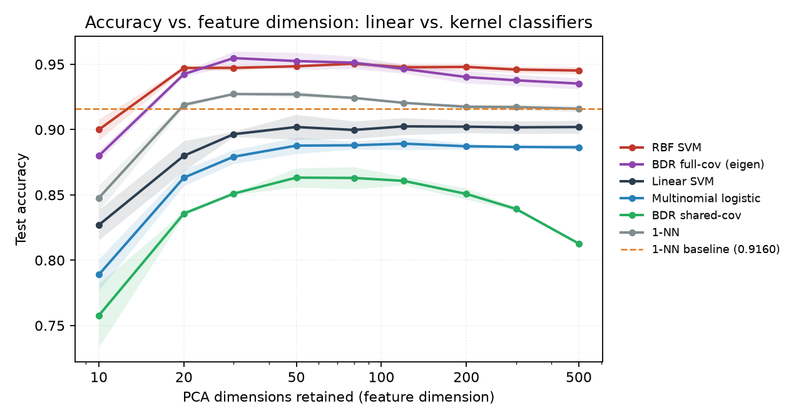

# Decomposing the "Kernel Gain"

**What actually buys accuracy on handwritten digits: the features, or the shape of the decision boundary?**

Course project for CS5487 Machine Learning (Assignment 3), City University of Hong Kong.
Team members: _TBD_.

---

## The question

Kernel methods are routinely reported to beat linear classifiers on MNIST-like data, and the
improvement is usually attributed to "nonlinearity". But three things change at once in that
comparison: the **feature space** (dimension), the **shape of the decision boundary**, and the
**effective regularisation**. This project isolates the middle one:

> At a fixed feature space, how much does a nonlinear decision boundary actually buy over the best
> linear model, and how does that gain depend on the number of retained dimensions?

## What the experiments show (preliminary results)

Reference: 1-NN on raw 784-d pixels = **0.9135 / 0.9185** (mean 0.9160 ± 0.0035), exactly
reproducing the baseline reported in the assignment.

Test accuracy (mean of the two provided trials), as a function of retained PCA dimensions:

| k | RBF SVM | BDR full-cov (QDA) | Linear SVM | Multinomial logistic | BDR shared-cov (LDA) | 1-NN |
|---|---|---|---|---|---|---|
| 10 | 0.9000 | 0.8800 | 0.8270 | 0.7890 | 0.7578 | 0.8478 |
| 20 | 0.9472 | 0.9425 | 0.8800 | 0.8632 | 0.8358 | 0.9190 |
| 30 | 0.9472 | **0.9548** | 0.8965 | 0.8792 | 0.8510 | 0.9272 |
| 50 | 0.9485 | 0.9525 | 0.9020 | 0.8878 | 0.8632 | 0.9270 |
| 100 | 0.9480 | 0.9500 | 0.9015 | 0.8880 | 0.8612 | 0.9228 |
| 200 | 0.9480 | 0.9402 | 0.9022 | 0.8872 | 0.8508 | 0.9175 |
| 500 | 0.9452 | 0.9352 | 0.9020 | 0.8865 | 0.8128 | 0.9160 |



Five observations:

1. **The binding constraint for linear models is boundary shape, not feature dimension.**
   Linear SVM sits at ≈0.902 from k = 50 all the way to k = 500 — 450 extra dimensions buy nothing.
2. **The kernel gain does not vanish with dimension.** It stabilises at **+4.3 to +5.1 pp** for
   k ≥ 30. If the advantage were merely "a different feature space", adding dimensions would close
   the gap; it does not.
3. **QDA is a narrow-band winner.** It reaches the best overall score (0.9548 at k = 30) but fails
   outright at 784 dimensions — the class covariance matrix is singular when *p* > *n* per class.
   Quadratic boundaries suffice, but they are extremely sensitive to how many dimensions you keep.
4. **Whitening never helps and is catastrophic at high k** (1-NN: 0.918 → 0.617 at k = 200). It
   rescales each direction by 1/√λ, amplifying low-variance noise directions that pollute the
   distance metric. A useful sanity check: non-shrunk LDA is invariant to any invertible linear
   transform, and its accuracy is indeed *bit-identical* with and without whitening, while
   shrinkage breaks that invariance.
5. **PCA-20 keeps only 65% of the pixel variance yet already supports 0.947** (784-d raw is
   0.9455). The discarded tail is mostly within-class variation, not class information.


Error analysis for the best configuration (QDA on 50 PCA dims): hardest digits are 8 (recall
0.917), 5 (0.925) and 9 (0.935); the most confused pairs are **3–5 (17 errors), 7–9 (13),
4–9 (11), 2–7 (11)**.

## Dataset and protocol

- Provided subset of MNIST: 4,000 images, 10 classes, 400 each, 784-d pixel vectors.
- Two trials; each has 2,000 training and 2,000 test images, and **no writer appears in both**,
  so the split measures generalisation across writers.
- Every hyper-parameter is chosen by 5-fold stratified cross-validation **inside the training
  set**. The test set is evaluated once per configuration — no test-set tuning.

**The dataset is not redistributed in this repository** (it is course material). Put the four
`digits4000*.txt` files in `data/digits4000_txt/` before running, or point `DIGITS_DIR` at them.

## Running it

```bash
python -m venv .venv && . .venv/bin/activate      # Windows: .venv\Scripts\activate
pip install -r requirements.txt

export OMP_NUM_THREADS=4 OPENBLAS_NUM_THREADS=4   # see note below

python check_baseline.py        # reproduces 0.9135 / 0.9185 - run this first
python run_grid.py             # classifier x preprocessing grid  (~13 min)
python run_sweep.py            # accuracy vs dimension            (~16 min)
python analyze.py              # markdown tables  -> results/
python figures.py              # figures          -> results/figs/
python confusion.py bdr_full pca50   # per-class recall + confusion matrix
```

`run_grid.py` and `run_sweep.py` append one JSON record per cell to `results/*.jsonl` and skip
cells that are already there, so they can be interrupted and resumed.

> **Threading note.** On machines with many cores, letting BLAS spawn one thread per core
> (20 here) made the process get OOM-killed with no error message — only `SIGTERM`. Capping to
> 4 threads fixed it and cost little. All timings above are with 4 threads.

## Repository layout

```
common.py          data loading (the txt files are transposed w.r.t. the MATLAB matrices!)
exp_lib.py         preprocessing variants, classifier grids, one-cell runner
run_grid.py        stage 1: classifier x preprocessing, 2 trials
run_sweep.py       stage 2: accuracy vs retained dimension
analyze.py         aggregates jsonl -> csv / markdown tables
figures.py         fig1-3
confusion.py       error analysis + fig4
check_baseline.py  baseline reproduction (sanity check on the data parsing)
results/           raw jsonl records, tables, figures, SUMMARY.md
proposal/          one-page project proposal (HTML source + PDF)
```

## Status

Implemented: baseline reproduction, full classifier × preprocessing grid, dimension sweep,
error analysis. Still to do for the final report: learning curves (training-set size), γ
sensitivity, explicit 1-vs-all confidence rules, and a small CNN as a "classical methods are
enough?" reference point.

---

Coursework for CS5487. Not licensed for reuse.
