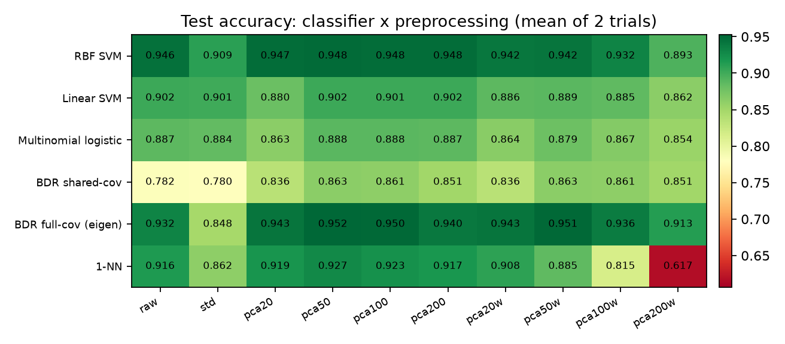
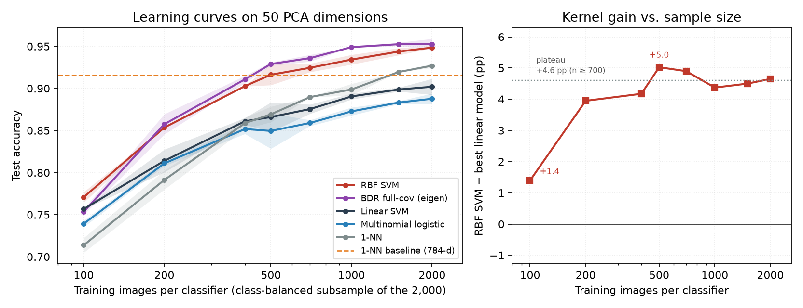
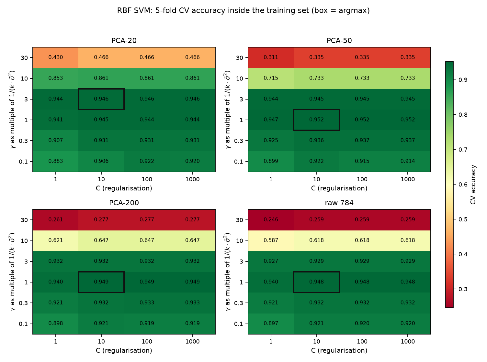

# Decomposing the "Kernel Gain"

**What actually buys accuracy on handwritten digits: the features, or the shape of the decision boundary?**

Course project for CS5487 Machine Learning (Assignment 3), City University of Hong Kong.
Team members: _TBD_.

---

## The question

Kernel methods are routinely reported to beat linear classifiers on MNIST-like data, and the
improvement is usually attributed to "nonlinearity". But three things change at once in that
comparison: the **feature space** (dimension), the **shape of the decision boundary**, and the
**effective regularisation**. This project isolates the middle one:

> At a fixed feature space, how much does a nonlinear decision boundary actually buy over the best
> linear model, and how does that gain depend on the number of retained dimensions?

## What the experiments show (preliminary results)

Reference: 1-NN on raw 784-d pixels = **0.9135 / 0.9185** (mean 0.9160 ± 0.0035), exactly
reproducing the baseline reported in the assignment.

Test accuracy (mean of the two provided trials), as a function of retained PCA dimensions:

| k | RBF SVM | BDR full-cov (QDA) | Linear SVM | Multinomial logistic | BDR shared-cov (LDA) | 1-NN |
|---|---|---|---|---|---|---|
| 10 | 0.9000 | 0.8800 | 0.8270 | 0.7890 | 0.7578 | 0.8478 |
| 20 | 0.9472 | 0.9425 | 0.8800 | 0.8632 | 0.8358 | 0.9190 |
| 30 | 0.9472 | **0.9548** | 0.8965 | 0.8792 | 0.8510 | 0.9272 |
| 50 | 0.9485 | 0.9525 | 0.9020 | 0.8878 | 0.8632 | 0.9270 |
| 100 | 0.9480 | 0.9500 | 0.9015 | 0.8880 | 0.8612 | 0.9228 |
| 200 | 0.9480 | 0.9402 | 0.9022 | 0.8872 | 0.8508 | 0.9175 |
| 500 | 0.9452 | 0.9352 | 0.9020 | 0.8865 | 0.8128 | 0.9160 |


Five observations:

1. **The binding constraint for linear models is boundary shape, not feature dimension.**
   Linear SVM sits at ≈0.902 from k = 50 all the way to k = 500 — 450 extra dimensions buy nothing.
2. **The kernel gain does not vanish with dimension.** It stabilises at **+4.3 to +5.1 pp** for
   k ≥ 30. If the advantage were merely "a different feature space", adding dimensions would close
   the gap; it does not.
3. **QDA is a narrow-band winner.** It reaches the best overall score (0.9548 at k = 30) but fails
   outright at 784 dimensions — the class covariance matrix is singular when *p* > *n* per class.
   Quadratic boundaries suffice, but they are extremely sensitive to how many dimensions you keep.
4. **Whitening never helps and is catastrophic at high k** (1-NN: 0.918 → 0.617 at k = 200). It
   rescales each direction by 1/√λ, amplifying low-variance noise directions that pollute the
   distance metric. A useful sanity check: non-shrunk LDA is invariant to any invertible linear
   transform, and its accuracy is indeed *bit-identical* with and without whitening, while
   shrinkage breaks that invariance.
5. **PCA-20 keeps only 65% of the pixel variance yet already supports 0.947** (784-d raw is
   0.9455). The discarded tail is mostly within-class variation, not class information.



Error analysis for the best configuration (QDA on 50 PCA dims): hardest digits are 8 (recall
0.917), 5 (0.925) and 9 (0.935); the most confused pairs are **3–5 (17 errors), 7–9 (13),
4–9 (11), 2–7 (11)**.

## Does the kernel gain depend on how much data you have?

A plausible objection to the result above: maybe nonlinearity only wins because 2,000 images is
"a lot" for a linear model to be out of its depth. To test it, each classifier is retrained on a
class-balanced subsample of the training set (n = 100 … 2,000), always on the same 50 PCA
dimensions, always with hyper-parameters re-tuned by 5-fold CV *inside* that subsample.

| n | RBF SVM | QDA (eigen) | Linear SVM | Logistic | 1-NN |
|---|---|---|---|---|---|
| 100 | **0.7708** | 0.7535 | 0.7568 | 0.7392 | 0.7138 |
| 200 | 0.8535 | 0.8575 | 0.8140 | 0.8110 | 0.7912 |
| 400 | 0.9028 | 0.9108 | 0.8610 | 0.8518 | 0.8588 |
| 500 | 0.9162 | 0.9290 | 0.8660 | 0.8495 | 0.8692 |
| 700 | 0.9245 | 0.9360 | 0.8755 | 0.8590 | 0.8898 |
| 1,000 | 0.9342 | 0.9490 | 0.8905 | 0.8728 | 0.8988 |
| 1,500 | 0.9438 | 0.9525 | 0.8988 | 0.8832 | 0.9195 |
| 2,000 | 0.9485 | **0.9525** | 0.9020 | 0.8878 | 0.9270 |



1. **The kernel gain is not a small-sample artefact — it grows with data.** It starts at
   **+1.4 pp** for n = 100, widens to **+5.0 pp** at n = 500, then settles at **+4.4 to +4.7 pp**.
   If nonlinearity were buying variance reduction on scarce data, the curve would go the other way.
2. **At n = 100 the ranking flips.** RBF SVM is the best model at the smallest sample size, while
   QDA is worst-but-one; from n = 200 the ordering reverses and QDA never loses again. Estimating
   785 covariance parameters per class needs data that 100 images do not provide.
3. **The chosen kernel width is not constant with n.** Expressed as a multiple of the
   median-distance heuristic 1/(k·σ̄²), the optimum is **0.1–0.3× at n = 100**, **0.3–1× at
   n = 200**, and **exactly 1× for every n ≥ 400** — i.e. less data prefers a smoother kernel.
   C is pinned at 10 throughout.
4. **1-NN is the most data-hungry model here** (0.714 → 0.927) and overtakes the linear SVM at
   n ≥ 700, from which point it keeps climbing while the linear models flatten.

## Is the kernel sitting on a knife edge?

A classifier that only works for one magic γ would make the comparison above uninteresting. The
surface below is **5-fold CV accuracy inside the training set** — deliberately not test accuracy,
so that the whole figure can be inspected without any risk of tuning on test data.



1. **γ is the sensitive knob; C is nearly irrelevant.** For every space, the four C columns are
   numerically identical once C ≥ 10; only C = 1 costs anything (and only slightly).
2. **The useful band is about one decade wide** (0.3–3 × the heuristic); 8/24 cells of the
   (γ, C) grid are within 1 pp of the best on PCA-20 and PCA-50, 4/24 on PCA-200 and raw pixels.
3. **Too large a γ is catastrophic, not merely suboptimal**: 30× gives 0.43 on PCA-20 but 0.25–0.31
   on the higher-dimensional spaces — a 60-plus point collapse from an over-local kernel.
4. **The median heuristic lands on the optimum on its own** (γ = 1×) in all four spaces. That is
   why the same γ grid scale is defensible across dimensions, and it is a useful practical takeaway.
5. **The best CV accuracy barely depends on dimension** (PCA-50 0.952, PCA-200 0.949, raw 784 0.948).
   Independent evidence for the main claim, obtained without touching the test set.

## Control group: a small CNN

Everything above holds the feature space fixed and varies the boundary. A convnet changes both,
so it is the natural control: if the whole "kernel gain" story were about boundary shape, a model
that *learns* its own translation-equivariant features should still be the one to beat.

Architecture: conv(16)-BN-ReLU-pool → conv(32)-BN-ReLU-pool → FC(128)-dropout → FC(10); Adam, 40
epochs max with early stopping on a 10% stratified slice of the training set, 2 seeds × 2 trials.
No augmentation — the point is the model class, not a tuned pipeline. In the learning-curve
figure above, the CNN appears as the black stars.

| n | Small CNN | RBF SVM | QDA (eigen) | Linear SVM |
|---|---|---|---|---|
| 500 | 0.9144 ± 0.0148 | 0.9162 | **0.9290** | 0.8660 |
| 1,000 | 0.9428 ± 0.0040 | 0.9342 | **0.9490** | 0.8905 |
| 2,000 | **0.9580 ± 0.0073** | 0.9485 | 0.9525 | 0.9020 |

1. **The CNN only wins at the largest sample size, and by half a point.** 0.9580 vs 0.9525 for
   QDA on 50 PCA dimensions. The claimed "deep learning" advantage is real but of the same order
   as the kernel-vs-linear gap (+4.7 pp) that this project set out to explain — not larger.
2. **At n ≤ 1,000 it loses to a quadratic discriminant.** With 50 PCA components and a
   quadratic boundary you are already at 94.9%, and the CNN has not yet amortised its parameters.
3. **Seed variance at n = 500 is larger than most effects discussed here** (0.9025–0.9360, a 3.3 pp
   spread over four runs). Any single-run CNN comparison at this scale is not a measurement.
4. **In-writer validation is optimistic by 2.4 pp on average** (validation accuracy minus test
   accuracy over all 12 runs). The validation slice is carved from the training set, so it shares
   writers with training while the test set does not. Early stopping on it therefore stops at a
   slightly wrong place, and any hyper-parameter chosen on it inherits the same bias. This is a
   concrete argument for why the assignment's writer-disjoint split matters.
5. **It is not the expensive option here.** Training one CNN takes 1.2 / 2.0 / 3.5 s at
   n = 500 / 1,000 / 2,000 on 4 CPU threads — less than one RBF SVM grid search cell (12–25 s).
   Whatever keeps deep models out of this project, it is not compute.

## Dataset and protocol

- Provided subset of MNIST: 4,000 images, 10 classes, 400 each, 784-d pixel vectors.
- Two trials; each has 2,000 training and 2,000 test images, and **no writer appears in both**,
  so the split measures generalisation across writers.
- Every hyper-parameter is chosen by 5-fold stratified cross-validation **inside the training
  set**. The test set is evaluated once per configuration — no test-set tuning.

**The dataset is not redistributed in this repository** (it is course material). Put the four
`digits4000*.txt` files in `data/digits4000_txt/` before running, or point `DIGITS_DIR` at them.

## Running it

```bash
python -m venv .venv && . .venv/bin/activate      # Windows: .venv\Scripts\activate
pip install -r requirements.txt

export OMP_NUM_THREADS=4 OPENBLAS_NUM_THREADS=4   # see note below

python check_baseline.py        # reproduces 0.9135 / 0.9185 - run this first
python run_grid.py             # classifier x preprocessing grid   (~13 min)
python run_sweep.py            # accuracy vs dimension             (~16 min)
python run_learning_curve.py   # accuracy vs training-set size     (~2 min)
python run_gamma_sensitivity.py  # (C, gamma) surface, training CV  (~18 min)
python analyze.py              # markdown tables  -> results/
python figures.py              # figures          -> results/figs/
python confusion.py bdr_full pca50   # per-class recall + confusion matrix

pip install -r requirements-cnn.txt   # optional, only for the control group
python cnn_control.py          # small CNN, 2 sizes x 2 seeds      (~1 min)
```

`run_grid.py` and `run_sweep.py` append one JSON record per cell to `results/*.jsonl` and skip
cells that are already there, so they can be interrupted and resumed.

> **Threading note.** On machines with many cores, letting BLAS spawn one thread per core
> (20 here) made the process get OOM-killed with no error message — only `SIGTERM`. Capping to
> 4 threads fixed it and cost little. All timings above are with 4 threads.

## Repository layout

```
common.py          data loading (the txt files are transposed w.r.t. the MATLAB matrices!)
exp_lib.py         preprocessing variants, classifier grids, one-cell runner
run_grid.py        stage 1: classifier x preprocessing, 2 trials
run_sweep.py       stage 2: accuracy vs retained dimension
run_learning_curve.py     stage 3: accuracy vs training-set size
run_gamma_sensitivity.py  stage 4: (C, gamma) surface from training-set CV
cnn_control.py     control group: small CNN vs the classical models
analyze.py         aggregates jsonl -> csv / markdown tables
figures.py         fig1-3, fig5-6
confusion.py       error analysis + fig4
check_baseline.py  baseline reproduction (sanity check on the data parsing)
results/           raw jsonl records, tables, figures, SUMMARY.md
proposal/          one-page project proposal (HTML source + PDF)
```

## Status

Implemented: baseline reproduction, full classifier × preprocessing grid, dimension sweep,
learning curves, (C, γ) sensitivity surface, error analysis, small-CNN control group.

Still to do for the final report: explicit 1-vs-all confidence rules (how to arbitrate when
several one-vs-all classifiers claim a digit), and the write-up itself.

---

Coursework for CS5487. Not licensed for reuse.
